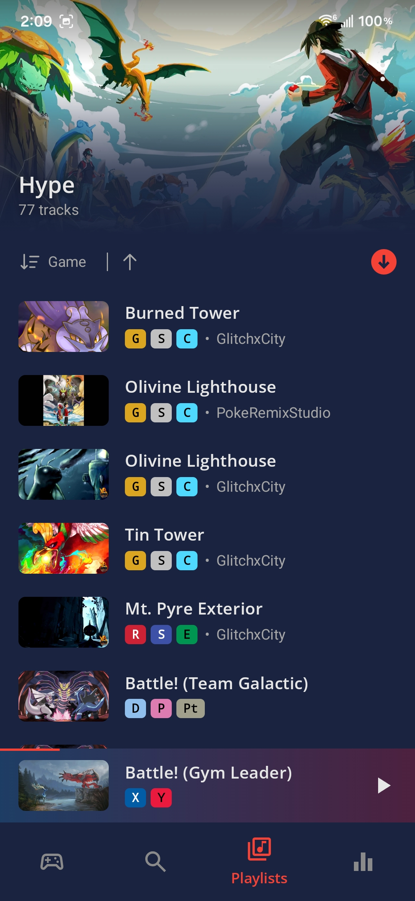
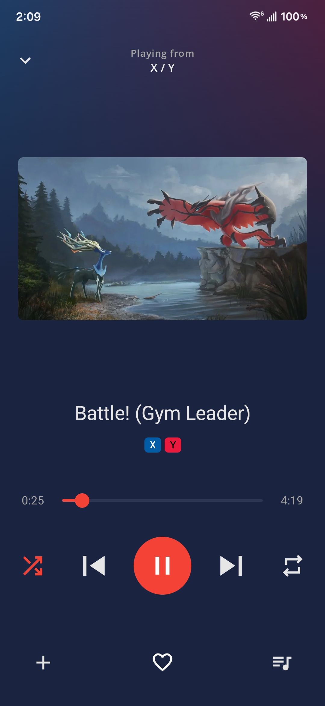
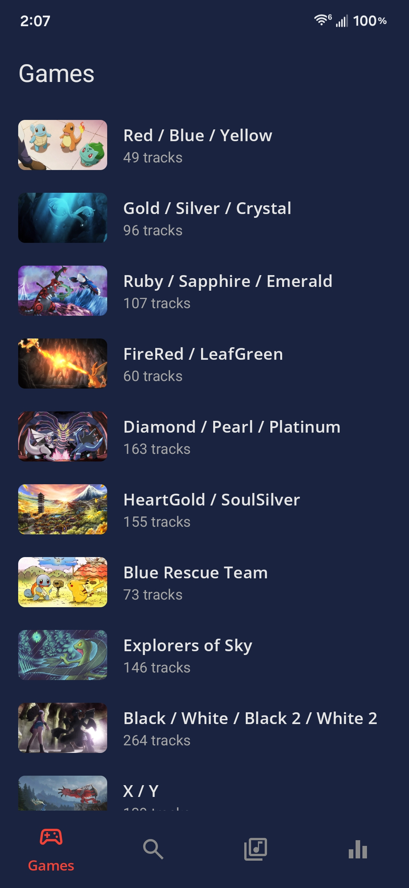

# VGMixr (Video Game Music Mixer)
VGMixr is an Android music player for video game soundtracks, with browsing by game, playlists, and offline downloads.

<table>
  <tr>
    <td align="center"> Games</td>
    <td align="center"> Now playing</td>
    <td align="center"> Playlist</td>
  </tr>
</table>

More info coming soon!